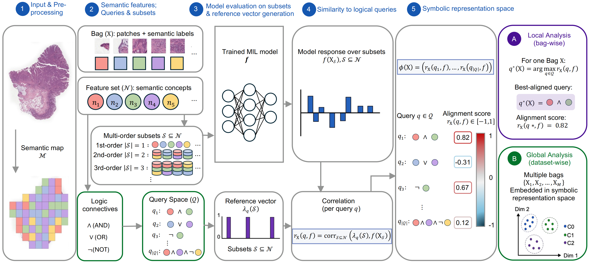

# Symb-xMIL

[**Symb-xMIL: Symbolic Explanations for Multiple Instance Learning in Digital Pathology**](https://arxiv.org/abs/2606.06224)

Yanqing Luo, Julius Hense, Niklas Prenissl, Andreas Mock, Klaus-Robert Mueller, Thomas Schnake, Mina Jamshidi Idaji

*Accepted at NeurIPS 2026 (poster).*



**Summary**: Symb-xMIL is a post-hoc symbolic explanation method for multiple instance learning (MIL). It perturbs a whole-slide image bag at the feature level, measures the model response for different feature subsets, and matches these responses to user-defined symbolic queries. The output is a per-bag symbolic explanation, such as `Tumor`, `(Mix ∧ Tumor)`, or `(Mix ∨ Tumor)`, together with a cohort-level analysis in the symbolic representation space.

## Repository Structure

- [`symb_xmil/`](symb_xmil/): the Symb-xMIL pipeline, including query generation, perturbation scoring, the xMIL model loader, and the symbolic representation space analysis.
- [`models/xMIL/`](models/xMIL/): an implementation following [xMIL](https://github.com/bifold-pathomics/xMIL) for training, testing, and loading MIL checkpoints. All experiments in the paper are based on the TransMIL architecture.
- [`semantic/`](semantic/): notebooks for deriving patch-level semantic labels.
- [`notebooks/`](notebooks/): analysis notebooks, such as recovering the logic of synthetic datasets and discovering patient subgroups in TCGA-HNSCC.

## Installation

Create and activate a Python environment, then install the dependencies. [`requirements.txt`](requirements.txt) pins the package versions tested in our development environment.

```bash
pip install -r requirements.txt
```

Alternatively, build the Apptainer/Singularity container from the provided recipe, [`symb_xmil.def`](symb_xmil.def):

```bash
apptainer build symb_xmil.sif symb_xmil.def
```

Dependencies for semantic labeling, such as [CellViT++](https://github.com/tio-ikim/cellvit-plus-plus), should be installed following the instructions in their repositories.

## Data

Camelyon16 slides, pixel-level annotations, and tumor size information are available from the [Camelyon16 Grand Challenge](https://camelyon16.grand-challenge.org/Data/). TCGA-HNSCC slides are available from [TCGA](https://www.cancer.gov/tcga), and the HPV status of the HNSCC cases was obtained from [cBioPortal](https://www.cbioportal.org/).

## Usage

### Semantic labeling

Symb-xMIL requires a semantic label for every patch. The [`semantic/`](semantic/) folder shows how these labels are derived for each dataset: from the pixel-level annotations for Camelyon16, and with CellViT++ for TCGA-HNSCC.

#### Defining your own features

Semantic maps are defined in [models/xMIL/datasets/data_handler.py](models/xMIL/datasets/data_handler.py) and selected by name. To add your own, called `<your_map>` below:

1. **Annotations**: save `<patch_metadata_dir>/<slide_id>/metadata/df.csv` per slide, with a `patch_id` column and an annotation column.
2. **Labeling**: in `SlideDataHandler.get_patch_labels` ([models/xMIL/datasets/data_handler.py](models/xMIL/datasets/data_handler.py)), add a function that turns annotation value into a feature name:

   ```python
   def _my_labels(x):
       return "Tumor" if x == 1 else "Normal"

   "my_map": ("my_annotation_column", _my_labels),
   ```
3. **IDs**: add `{"<FeatureA>": 0, "<FeatureB>": 1, ..., "Empty": -1}` under `"<your_map>"` to both `SlideDataHandler._LABEL_MAPS` and `QueryGenerator.LABEL_MAPS` ([symb_xmil/queries.py](symb_xmil/queries.py)), and add the key to `QueryGenerator._get_label_map`. Patches labeled `-1` are ignored.

Then use `semantic_map="<your_map>"` and pass the feature IDs as `concepts`.

### Model training

Data preprocessing, data splitting, and model training follow the [xMIL](https://github.com/bifold-pathomics/xMIL) workflow. The test performance on the datasets evaluated in our paper is:

| Dataset | Task | Model | Test performance |
| --- | --- | --- | --- |
| Synthetic AND | Binary classification | TransMIL | AUROC 0.999 |
| Synthetic OR | Binary classification | TransMIL | AUROC 0.999 |
| Synthetic IMP | Binary classification | TransMIL | AUROC 0.999 |
| Camelyon16 | Binary tumor classification | TransMIL | AUROC 0.995 (0.010) |
| TCGA-HNSCC | Binary HPV status classification | TransMIL | AUROC 0.899 (0.039) |

### Symb-xMIL explanation

#### 1. Load a trained xMIL model

```python
import torch

from symb_xmil import QueryGenerator, PerturbationScorer, load_xmil, run_symbolic_xmil

device = "cuda" if torch.cuda.is_available() else "cpu"

model, classifier, test_loader = load_xmil(
    model_dir="/path/to/xmil/checkpoint",
    test_subsets=["test"],    # or a fold number for held-out cross-validation
    patch_metadata_dirs=["/path/to/patch_label_metadata"],
    semantic_map="camelyon",  # semantic map M; see models/xMIL/datasets/data_handler.py for others
    device=device,
)
```

#### 2. Define the features to explain

The semantic map $\mathcal{M}$ assigns each patch a feature type, and $\mathcal{N}$ is the set of features used for the explanation. For Camelyon16, for example:

```python
# Camelyon16 semantic map:
# {"Empty": -1, "Normal": 0, "Mix": 1, "Tumor": 2}
concepts = [0, 1, 2]
```

The features must be given explicitly: `run_symbolic_xmil` raises an error if `concepts` is not provided.

#### 3. Define the queries

```python
query_gen = QueryGenerator(
    max_query_size=3,         # k: maximum number of features per query
    semantic_map="camelyon",  # also supports camelyon_cellvit, hnsc_majority_border
    negation=False,
)
```

The query set $\mathcal{Q}$ consists of symbolic formulas over at most $k$ features, such as `Mix` or `(Mix ∨ Tumor)`. Each query $q$ has an indicator $\lambda_q(\mathcal{S})$ on every feature subset $\mathcal{S}$. The queries are generated over the features $\mathcal{N}$ passed to `run_symbolic_xmil` in step 5.

#### 4. Create the perturbation scorer

```python
scorer = PerturbationScorer(
    classifier=classifier,
    explained_class=-1,          # -1 is the last class, usually class 1 in binary classification
    device=torch.device(device),
)
```

For a bag $\mathbf{X}$ and a feature subset $\mathcal{S}$, the scorer computes $f(\mathbf{X}_{\mathcal{S}})$, the scalar model output on the sub-bag $\mathbf{X}_{\mathcal{S}}$ that keeps only the patches whose feature lies in $\mathcal{S}$.

#### 5. Run Symb-xMIL

```python
results = run_symbolic_xmil(
    scorer=scorer,
    dataloader=test_loader,
    results_dir="/path/to/results",
    query_gen=query_gen,
    concepts=concepts,
    max_subset_size=None,  # None: all non-empty subsets S of N, as in the paper
    verbose=True,
    save_mapped=True,
)
```

#### 6. Outputs

The following files are written to `results_dir`:

- `raw_output_for_subsets.csv`: the sub-bag outputs $f(\mathbf{X}_{\mathcal{S}})$ for each bag.
- `alignment_scores.csv`: the alignment scores $r_{\mathbf{X}}(q, f)$, i.e. the Pearson correlations between $f(\mathbf{X}_{\mathcal{S}})$ and each query indicator $\lambda_q(\mathcal{S})$. With `negation=True`, the file is named `alignment_scores_with_negation.csv`.
- `best_queries.csv`: for each bag, the best-aligned query $q^*(\mathbf{X})$ and its score (`best_query`, `best_alignment_score`), followed by the alignment scores of all queries.
- `alignment_scores_mapped.csv`: written when `save_mapped=True`; a copy of the alignment scores with feature IDs replaced by feature names.

#### Command line

The same pipeline is available as a script, [`symb_xmil/scripts/run_symbolic_xmil.py`](symb_xmil/scripts/run_symbolic_xmil.py):

```bash
python symb_xmil/scripts/run_symbolic_xmil.py \
    --model-dir /path/to/xmil/checkpoint \
    --results-dir /path/to/results \
    --test-subsets test \
    --patch-metadata-dirs /path/to/patch_label_metadata \
    --semantic-map camelyon \
    --concepts 0,1,2 \
    --max-query-size 3 \
    --device cuda
```

Run with `--help` to see all options. The script also writes `run_config.json` and `runtime_summary.json` to the results directory.

#### 7. Symbolic representation space

[`symb_xmil/symbolic_representation_space.py`](symb_xmil/symbolic_representation_space.py) analyzes the dataset in the symbolic representation space, where each bag is represented by $\phi(\mathbf{X})$, its vector of alignment scores over all queries.

```python
from symb_xmil.symbolic_representation_space import plot_symbolic_representation_space

plot_df, enriched_df, cluster_report = plot_symbolic_representation_space(
    results["best_df"],  # or "/path/to/results/best_queries.csv"
    min_query_count=3,
    use_kmeans=True,
    output_path="/path/to/results/pca_symbolic_representation_space.png",
)
```

This projects $\phi(\mathbf{X})$ to 2D with PCA, colors each bag by its best query $q^*(\mathbf{X})$ (`best_query`), and optionally adds KMeans clusters.

## Contact

For questions or issues, please open a GitHub issue or contact [Yanqing Luo](mailto:yanqing.luo@tu-berlin.de).

## Citation

```bibtex
@article{luo2026symb,
  title={Symb-xMIL: Symbolic Explanations for Multiple Instance Learning in Digital Pathology},
  author={Luo, Yanqing and Hense, Julius and Preni{\ss}l, Niklas and Mock, Andreas and M{\"u}ller, Klaus-Robert and Schnake, Thomas and Idaji, Mina Jamshidi},
  journal={arXiv preprint arXiv:2606.06224},
  year={2026}
}
```

## License

This code is released under the MIT License. See [LICENSE](LICENSE) for details.

Note: the license was changed from CC BY-NC-ND 4.0 to MIT in April 2026.
